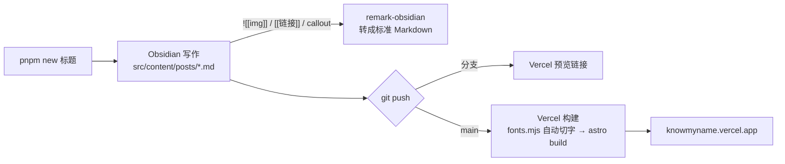

# knowmyname · Shane 的博客

Shane（TreeTreeDi）的个人博客：文章（按年分组）、作品、生活。首页顶部是一条实时 WebGPU 海面，整站底色和字色跟着北京时间的清晨 / 正午 / 日落 / 夜晚变。

- 线上：<https://knowmyname.vercel.app>
- 仓库：<https://github.com/TreeTreeDi/knowmyname>（push 到 `main` 自动部署，其他分支自动出预览链接）

## 写一篇新文章（3 步）

```bash
pnpm new "文章标题" my-slug      # 1. 生成 src/content/posts/my-slug.md（draft: true）
# 2. 在 Obsidian 里写；图片拖进来即可（存到 posts/assets/，![[图.png]] 会自动转成标准图片）
git add -A && git commit -m "post: 文章标题" && git push   # 3. 把 draft 改成 false 后 push，Vercel 自动上线
```



细节：

- **在哪写**：用 Obsidian「打开文件夹作为仓库」打开 `src/content/posts/`。设置 → 文件与链接 → 新附件位置选「当前文件夹下指定的子文件夹」，填 `assets`。这样粘贴的图片会落在 `src/content/posts/assets/`，`![[图.png]]`、`![[图.png|600]]` 都能直接构建。`.obsidian/` 已被 git 忽略。
- **草稿**：`draft: true` 的文章在 `pnpm dev` 里能看到（标着 draft），生产构建里不会出现。
- **slug**：文件名就是网址，`posts/my-slug.md` → `/posts/my-slug/`。不给 slug 时，会用标题里的英文单词；标题全是中文就用日期。
- **Obsidian 语法支持**（`src/lib/remark-obsidian.mjs`）：`![[img]]`、`![[img|宽]]`、``、`[[笔记]]` / `[[笔记|文字]]`（转成纯文字）、`> [!tip]` callout，以及 `[[toc]]`（会被去掉，页面自带目录）。` ```mermaid ` 代码块在浏览器里渲染。
- **字体**：`pnpm dev` 和 `pnpm build` 开头都会先跑 `scripts/fonts.mjs`。它扫描 `src/` 里所有非 ASCII 字符，从 `fonts-src/oppo-sans-source.woff2` 切出约 230 KB 的站点子集。新文章里的生僻字会自动包含进去，不用手动处理。
- **本地预览**：`pnpm dev`，然后打开 <http://localhost:4331>。上线前可以跑 `pnpm build` 检查。
- **想从 Obsidian 里直接 push**：装 Obsidian Git 插件（`Git: Commit-and-sync`）。不装也行，终端里 git push 是一样的。

这条链路参考了：

- Nick Ang，[How to publish a blog using Obsidian with Astro](https://nickang.com/how-to-publish-a-blog-using-obsidian-with-astro/)：仓库里的文件夹直接当 Obsidian vault，Astro 的 glob loader 读同一批文件，再用 remark 插件转换 wikilink。
- Bas Châtel，[Website Setup](https://www.baschatel.nl/articles/website-setup/)：附件放在笔记旁的子文件夹里，用 remark 插件把 `![[…]]` 转成标准图片。
- Vault CMS，[Publishing](https://docs.vaultcms.org/concepts/publishing/)：发布就是 `git push`，草稿用 `draft: true`，用 Obsidian Git 推送。
- Eliot Bendinelli，[Syncing Obsidian notes with Astro](https://bndy.org/posts/syncing-obsidian-notes-with-astro/)：如果想在已有的大 vault（如 `~/workspace/knowledge`）里写，可以用 sparse-checkout 把这个仓库的 `src/content/posts` 拉进 vault。
- Astro，[Markdown 处理器](https://docs.astro.build/en/guides/markdown-content/) 和 [v7 升级说明](https://docs.astro.build/en/guides/upgrade-to/v7/)：Astro 7 默认的 Sätteri 不跑 remark 插件，所以这里显式用 `unified()`。
- Vercel，[Supported Node.js versions](https://vercel.com/docs/functions/runtimes/node-js/node-js-versions)：Vercel 支持 26.x（默认）、24.x 和 22.x。`package.json` 的 `engines.node: "24.x"` 会覆盖项目设置，锁定在 Node 24。

## 运行

需要 Node 24（`.nvmrc`）和 pnpm。

```bash
pnpm install
pnpm dev          # http://localhost:4331
pnpm build        # 纯静态产物在 dist/
```

调试参数：

- `?time=dawn|noon|dusk|night`：切换时段（本标签页内记住，`?time=auto` 恢复）。顶栏最右的图标也能循环切换。
- `?gl`：强制 WebGL2。
- `?static`：不启动渲染器。

## 结构

| 页面 | 内容 |
| --- | --- |
| `/` | 海面条、名字和简介、最近 5 篇文章、作品、4 张生活照 |
| `/posts/` | 全部文章，按年分组 |
| `/posts/<slug>/` | 文章页：目录（宽屏在左侧，窄屏折叠）、正文、mermaid |
| `/projects/` | Now / Built 两组作品 |
| `/life/` | 照片网格，点击用原生 Popover 打开大图 |
| `/feed.xml` | RSS |

```
src/
  content/posts/*.md   文章（title / date / description? / minutes? / draft?）；图片放 posts/assets/
  data/  projects.ts · life.ts · redirects.json（旧网址 → 新 slug）
  lib/   posts.ts · remark-obsidian.mjs · time.ts
  components/  Ocean.tsx（海面，唯一的 React 岛）· SiteHeader / SiteFooter / PostItem / ProjectCard / Moment …
  assets/life/   生活照片（构建时压缩成 webp）
  styles/global.css   全部样式；四个时段各一组 CSS 变量
fonts-src/   OPPO Sans 源子集（GB2312 + 符号，2.8 MB），build 时从这里切站点子集
public/fonts/  GB2312 常用字分片（`pnpm fonts:slices` 一次性生成，已提交）
scripts/  new-post.mjs · fonts.mjs · subset-fonts.py · screenshots.mjs · textcount.mjs
```

## 从 treetreedi.me 迁移的内容

来源：[TreeTreeDi/treetreedi.me](https://github.com/TreeTreeDi/treetreedi.me)。旧仓库只读取，没有改动。

- **文章**：线上的 9 篇全部迁移，正文、日期、描述和图片都保留。图片仍然引用 `TreeTreeDi/my-image-here` 图床。
  - 另有一篇《算法 字符串操作 & KMP 解决问题》，旧站没有 frontmatter，也没有上线，这里作为 `draft: true` 保留。
- **网址**：英文 slug 原样保留。6 个中文文件名的旧网址在 `src/data/redirects.json` 里做了 301 跳转到新的英文 slug。
- **作品**：CloudQuery（Now）、StreamFusion、Multi-Mode Selection、markdown-flow。
- **生活**：10 张照片（其中 2 张 HEIC 已转成 JPG）。旧仓库里有一张星轨照片来自 antfu.me 模板，不是 Shane 的，没有迁移。
- **首页**：简介和 GitHub 链接；页脚是 CC BY-NC-SA 4.0 © TreeTreeDi。

## 技术要点

- **Astro 7 静态输出**，React 只用于首页海面（`client:only`）。Markdown 用 `unified()` 处理器，以便跑 Obsidian 兼容插件。
- **海面**：three.js r187 `WebGPURenderer` + TSL（`WaterMesh` + `SkyMesh` + bloom）。
  - 按容器尺寸渲染，海平线约在 62% 处。
  - 没有 WebGPU 时退回 WebGL2，再不行就显示静态帧。
  - 滚出视口时暂停；开启「减少动态效果」时只显示静态帧。
- **跟着时间的光**：`<html data-time>` 在首帧前按 Asia/Shanghai 设定（05–08 清晨、08–16 正午、16–19 日落、其余夜晚）。夜晚代码和 mermaid 用暗色主题。
- **依赖策略**：`pnpm-workspace.yaml` 里设了 `minimumReleaseAge: 1440`，不安装发布不满 24 小时的包。被波及的间接依赖用 `overrides` 固定在上一个版本。
